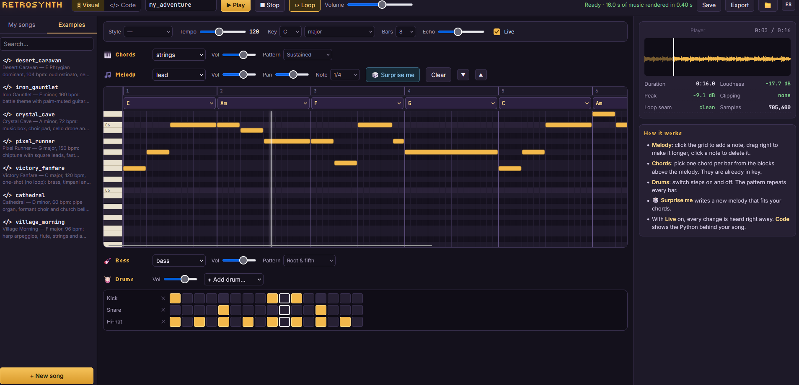

# retrosynth

[](https://github.com/morjoos-dev/retrosynth/actions/workflows/tests.yml)

**Make 16-bit style game music — visually or in Python.** A synthesizer built from scratch on numpy/scipy
(oscillators, filters, plucked strings, FM bells, formant choirs, reverb) with a web studio where you can compose
with tracks, no code needed, or write songs as Python scripts.

**Install:** [step-by-step guide for Windows, macOS, Linux and more](docs/INSTALL.md) ·
[guía en español](docs/INSTALL.es.md)



For programmers, a song is just Python:

```python
from retrosynth import *

s = Song(bpm=96, bars=8)
for bar, ch in enumerate(progression("F:4 Dm:4 Bb:4 C:4  F:4 Dm:4 Gm:4 C:4")):
    arpeggio(s, bar, ch.notes, [0, 1, 2, 3, 2, 1, 0, 1], gain=0.09)       # harp
    s.put(inst.bass(midi(ch.notes[0] - 12), s.beat * 1.8), s.at(bar), gain=0.3)

s.melody("flute", 0, mel("A5:1.5 G5:0.5 F5:1 C5:1   D5:1.5 E5:0.5 F5:1 A5:1"), gain=0.24, wet=0.4)
song = s.render(reverb_size=1.2, loudness=0.12)
```

## Features

- **Visual editor for non-programmers**: pick a style (adventure, village, cave, battle, desert, chiptune),
  then draw the melody on a piano roll, choose chords per bar (always in key), pick bass and chord patterns
  and switch drum steps on and off. Changes are heard live while it plays, and **🎲 Surprise me** writes a
  new melody that fits the chords. The **Code** tab shows the Python generated from your tracks.
- **English and Spanish interface**.
- **43 instruments** synthesized from first principles: square leads with vibrato and portamento,
  Karplus-Strong harp and oud, FM bells, bowed strings with body resonances, a formant choir that sings
  vowels, organ drawbars, distorted guitars, a full drum kit, world percussion and cinematic effects.
- **Seamless loops**: the reverb tail that rings past the last bar is folded back onto the start, so tracks
  loop with no click (the studio measures the seam for you).
- **Consistent loudness**: every track is normalised to a target RMS and passed through a soft limiter.
- **Deterministic**: randomness is seeded per song, so the same code always produces the same audio.
- **Web studio**: code editor with error-line highlighting, waveform with seek, loop playback, mix analysis
  (loudness, peak, clipping, loop seam), and a playable on-screen keyboard that records melodies straight
  into code.
- **Export** to WAV, and to OGG / MP3 when ffmpeg is installed (game engines like OGG).
- **Fast**: a 40-second, 16-bar arrangement renders in about one second.

## Quick start

**Easiest:** install Python 3.10+, download the project and double-click `start-windows.bat` (Windows) or
`start-macos.command` (macOS), or run `./start.sh` (Linux). The first run sets everything up. Full
instructions for every platform, including Docker, Chromebook and Raspberry Pi, are in
[docs/INSTALL.md](docs/INSTALL.md).

**With pip:**

```bash
git clone https://github.com/morjoos-dev/retrosynth.git
cd retrosynth
pip install -e .

retrosynth studio                  # opens http://localhost:5177
retrosynth render crystal_cave     # render a bundled example to ./output
retrosynth render my_song.py -f wav,ogg
retrosynth list                    # examples and instruments
```

Install [ffmpeg](https://ffmpeg.org/download.html) (or set the `FFMPEG` environment variable) to export OGG
and MP3; without it you still get WAV. Or run everything in Docker: `docker build -t retrosynth .` (see the guide).

## Examples

All bundled songs are original compositions written for this project.

| Song | Style |
| --- | --- |
| `village_morning` | Pastoral F major: harp arpeggios, flute, strings |
| `crystal_cave` | Ambient A minor: music box, choir pad and randomly placed water drops |
| `iron_gauntlet` | 160 bpm battle theme: palm-muted guitars, gliding lead, double kick |
| `desert_caravan` | E Phrygian dominant: oud ostinato, ney, maqsum rhythm on doumbek |
| `cathedral` | Pipe organ, formant choir and church bells in a large hall |
| `pixel_runner` | Chiptune: square leads, 16th-note arpeggios, triangle bass |
| `victory_fanfare` | One-shot brass fanfare with a timpani roll |

## Writing songs

A song is a Python script that builds a `Song` and assigns it to `song`:

| | |
| --- | --- |
| `Song(bpm, bars, beats_per_bar=4, loop=True)` | The timeline. `loop=False` for one-shot cues. |
| `s.at(bar, beat)` | Bar/beat → seconds. |
| `s.put(sound, time, gain=, pan=, wet=)` | Mix any mono array in (`pan` −1…1, `wet` = reverb send). |
| `s.melody(instrument, bar, notes, legato=, transpose=, glide=)` | Play a melody. |
| `mel("C5:1 E5:0.5 r:0.5")` | Melody notation: `pitch:beats`, `r` = rest. |
| `chord("A2", "min")`, `progression("C:4 Am:4 G7:2")` | Chords and timed chord charts. |
| `pad`, `arpeggio`, `drum_pattern("x...x.x.")`, `rock_drums` | Arrangement helpers. |
| `inst.<name>(freq, seconds)` | Any instrument as a raw sound. |
| `osc`, `adsr`, `lowpass`, `bandpass`, `karplus_strong`, … | DSP building blocks for your own instruments. |

Your own instruments are just functions returning a numpy array:

```python
def wobble(freq, dur):
    x = osc(dur + 0.1, freq, "saw")
    x = lowpass(x, lambda t: 800 + 600 * np.sin(2 * np.pi * 6 * t), q=2)
    return adsr(x, 0.01, 0.1, 0.8, 0.1, dur)

s.melody(wobble, 0, mel("C3:1 Eb3:1 G3:2"))
```

## How it works

```
song script ──► Song ──► dry bus (stereo) ─────────────────┐
                  │                                        ├─► fold tail onto start ─► normalise ─► soft limit
                  └────► reverb send ─► Schroeder reverb ──┘
```

**No per-sample Python loops.** Classic synthesis algorithms are recursive, which usually means slow Python
loops. Here each one is rewritten as an equivalent linear filter and handed to `scipy.signal.lfilter`:

- **State-variable filter.** The Chamberlin SVF (`low += f·band; high = x − low − d·band; band += f·high`) is
  linear for fixed coefficients, so its low/high/band outputs are biquads sharing the denominator
  `1 + (f² + f·d − 2)z⁻¹ + (1 − f·d)z⁻²`. Filters with a moving cutoff are processed in 32-sample blocks,
  with the SVF state carried exactly across blocks through the transposed-direct-form state.
- **Karplus-Strong.** The plucked-string recurrence `y[n] = g·((1−b)·y[n−L] + b·y[n−L+1])` is an IIR filter.
  Short delays (high notes) go straight through `lfilter`; long delays are computed one period at a time as
  vector operations.
- **Schroeder reverb.** A feedback comb `w[n] = x[n] + g·w[n−d]` becomes a one-pole filter running down the
  columns of the signal folded into rows of length `d`.

`tests/test_dsp.py` checks every one of these against a plain per-sample reference implementation.

**One source of truth for visual songs.** The visual editor edits a small JSON project; `arrange.py`
validates it strictly and generates a readable song script, and *that script is what runs*, so the Code tab can
never disagree with what you hear. The project is embedded in the script on a comment line, so saved songs reopen
in the visual editor and still render from the command line like any other script.

**The studio runs your code safely.** Song scripts execute in a separate worker process with a time limit; a
runaway `while True` is killed, and a new render cancels the one in progress. The server binds to
`127.0.0.1`, every API call needs a per-session token embedded in the page (blocking CSRF from other sites),
and the `Host` header must be a loopback name (blocking DNS rebinding).

## Project layout

```
src/retrosynth/
  dsp.py           oscillators, envelopes, filters, Karplus-Strong, reverb
  instruments.py   the instrument library and its registry
  song.py          Song, melodies, chords, arrangement helpers, mixdown
  arrange.py       visual-editor projects -> validated, readable song scripts
  presets.py       starting styles for the visual editor
  runner.py        executes song scripts, reports errors with line numbers
  worker.py        sandboxed render process with timeout and cancellation
  analysis.py      loudness, peak, clipping and loop-seam measurements
  audio_io.py      WAV writer and ffmpeg export
  server.py        FastAPI studio backend
  cli.py           `retrosynth` command
  web/             studio front end: app.js, visual.js (track editor), i18n.js (EN/ES)
  examples/        bundled songs
tests/             pytest suite (DSP references, songs, visual projects, runner, worker, server)
docs/              installation guides (English and Spanish)
start-windows.bat  start.sh  start-macos.command    double-click launchers
Dockerfile
```

## Development

```bash
pip install -e ".[dev]"
pytest
ruff check .
```

## License

[MIT](LICENSE)

---

## En español

**retrosynth** es un sintetizador escrito desde cero en Python (numpy/scipy) para componer música de
videojuego de estilo 16 bits. **No hace falta saber programar**: en el modo visual eliges un estilo, dibujas
la melodía en una cuadrícula, eliges los acordes de cada compás y enciendes los pasos de la batería, y todo
suena al momento. Quien sepa Python puede escribir los temas como código. La interfaz está en español y en inglés.

**Instalación:** [guía paso a paso para Windows, macOS, Linux y más](docs/INSTALL.es.md). En resumen:
instala Python 3.10 o superior, descarga el proyecto y haz doble clic en `start-windows.bat` (Windows) o
`start-macos.command` (macOS), o ejecuta `./start.sh` (Linux).

Todos los temas de ejemplo son composiciones originales hechas para este proyecto.
